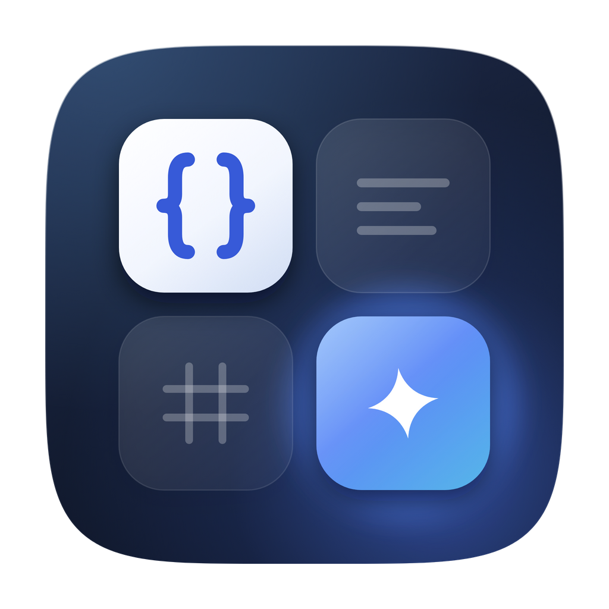
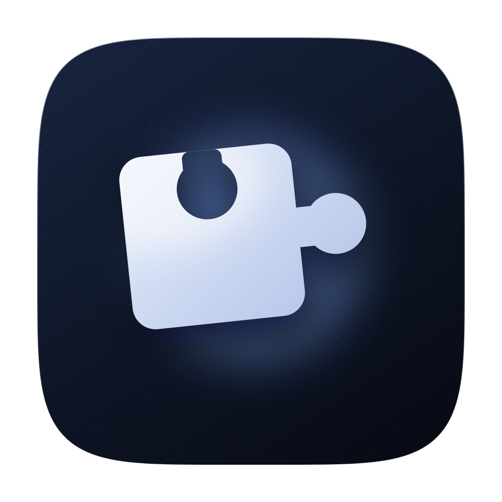
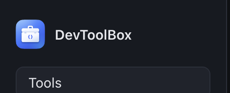

# DevToolBox 应用图标 · 方案提案

> 三个方向均为 1024 × 1024 矢量源（SVG），已渲染为透明 PNG，并做过 128 / 64 / 32 / 16 px 的 Dock 尺寸验证。
> **已选定方案 B · 开发者工具箱（Dev Kit），并已完成项目替换**，落地记录见文末。

---

## 1. 设计依据

| 维度 | 结论 | 对图标的要求 |
| --- | --- | --- |
| 使用场景 | 跨平台桌面应用（Tauri：macOS `.dmg` / Windows NSIS），常驻 Dock 与任务栏，随开随用 | 小尺寸优先；有 macOS 风格的圆角方形轮廓；暗色/浅色桌面都要立得住 |
| 核心功能 | 7 个内置工具（Base64、JSON、JWT、URL、Regex、UUID、IP）+ Marketplace 插件；一个工作台、一个搜索框；插件权限受控 | 需要"多工具 / 模块化 / 可扩展 / 可信"的视觉线索 |
| 用户群体 | 开发者、DevOps/SRE、测试与技术支持、注重隐私的高级用户 | 克制的工程感，不要"魔法感"和通用 SaaS 渐变球；避免和 IDE/终端类图标撞脸 |
| 品牌现状 | 现有图标是蓝渐变底 + "DT" 细字 | 去文字化，建立可延续的图形符号；沿用品牌蓝 `#4F8CFF` 家族 |
| 技术约束 | 需要导出 `.icns` / `.ico` / 各尺寸 PNG | 单一 1024 源、纯矢量、无外部字体、透明留白一致 |

三个方案分别对应产品的三个叙事：**工作台（模块）**、**盒子（工具）**、**生态（插件）**。

---

## A · 模块矩阵 — Module Matrix



- **概念**：深墨蓝底上四枚模块，左上白色模块里是 `{}`，右下高亮模块带一枚"生成"星芒，另外两枚为磨砂玻璃。
- **语义**：一个工作台装下所有工具。白色 = 已启用的内置工具；玻璃 = 可安装的插件；高亮 = 当前工具 / 生成结果。四宫格本身就是"工具选择器"的抽象。
- **为什么适合**：直接映射"内置模块 + 插件市场"的结构，也映射左侧工具列表 + 右侧面板的界面。四块体量在 32 px 仍能读出网格，16 px 仍保留"白块 + 蓝块"的对比。
- **色板**：底 `#1E2E52 → #090E1B`，高亮 `#74B4FF → #23B6F0`，白模块 `#FFFFFF → #D3E1F8`，品牌蓝线 `#4F8CFF`。
- **风险**：四宫格容易联想到"应用抽屉"；用一大一小、一白一蓝的非对称处理拉开差异。

---

## B · 开发者工具箱 — Dev Kit


- **概念**：品牌蓝渐变底，一只白色工具箱：提手、两只金属卡扣、箱面一枚 `{}`。
- **语义**：DevToolBox 的"盒子"本体——随身的开发者工具箱。卡扣象征插件的权限与安全边界，`{}` 点明开发者身份。
- **为什么适合**：最直白、最亲和，和产品名同构；在应用商店/安装包里辨识成本最低。蓝底白箱的对比在深色与浅色桌面上都稳定。
- **色板**：底 `#6AAEFF → #3D77FF → #2A34D8`，箱体 `#FFFFFF → #C9DAF6`，卡扣 `#EAF2FF → #C6D6F2`，符号 `#2E5BFF`。
- **风险**：轮廓接近"公文包/手提箱"；靠双卡扣、`{}` 与工具感的比例把语义拉回"工具箱"。

---

## C · 插件拼图 — Plugin Piece



- **概念**：深墨蓝底、蓝色光晕，一块白色拼图从暗处浮起；上方凹槽、右侧凸榫。
- **语义**：每个插件都严丝合缝地接进工作台；凹槽/凸榫也是"能力插槽 + 权限门"的隐喻。留白与光晕强调"从 Marketplace 取用"的动作。
- **为什么适合**：Marketplace 是产品相对同类工具最显性的差异点；拼图是全人类都懂的"扩展"符号。白色实体在深色 Dock 里非常跳。
- **色板**：底 `#152340 → #070B14`，拼图 `#FFFFFF → #A3BEEA`，光晕 `#4F8CFF`。
- **风险**：单块拼图在小尺寸下容易变成"白色方块"；靠凹槽+凸榫的非对称轮廓和蓝色光晕维持识别。

---

## 推荐

- **首选 A（模块矩阵）**：信息层次最好，和暗色 UI 同源，32 px 仍能读出"四个工具"；后续做启动页、favicon、插件商店横幅都容易延展。
- 若品牌更想"有人味、好记"→ **B**。
- 若接下来要主推 Marketplace → **C**。

个人排序：**A > C > B**。

> **最终选择：B · 开发者工具箱（Dev Kit）**，已替换进项目，详见文末「落地记录」。

---

## 目录结构

```
design/icon/
├── src/                      # 三个方案的 1024 矢量源
│   ├── icon-a-module-matrix.svg
│   ├── icon-b-devkit-case.svg
│   └── icon-c-plugin-piece.svg
├── render/                   # 1024 × 1024 透明 PNG
├── preview/
│   ├── compare-dark.png      # 深色桌面下的尺寸对比
│   └── compare-light.png     # 浅色桌面下的尺寸对比
├── drafts/                   # 探索稿（命令行、双斜杠、四边拼图等，未采用）
└── tools/
    ├── generate.py           # 生成 SVG
    ├── render.js             # Electron 离屏渲染 PNG
    └── preview.py            # 生成对比图
```

## 重新生成

```bash
cd design/icon
python3 tools/generate.py
# macOS 上使用仓库自带 Electron 离屏渲染
env -u ELECTRON_RUN_AS_NODE ../../node_modules/electron/dist/Electron.app/Contents/MacOS/Electron \
  --no-sandbox --disable-gpu tools/render.js
/Users/jacobs/.dsh/dsh-runtimes/dsh-primary-runtime/dependencies/python/bin/python3 tools/preview.py
```

## 落地记录（方案 B）

| 位置 | 变更 |
| --- | --- |
| `apps/desktop/app-icon.png` | 替换为 B 方案 1024 × 1024 源图 |
| `apps/desktop/src-tauri/icons/` | 由 `tauri icon` 重新生成：`32x32`、`64x64`、`128x128`、`128x128@2x`、`icon.png`、`icon.icns`、`icon.ico`、`Square*Logo`、`StoreLogo`、Android/iOS 全套 |
| `apps/desktop/src/assets/brand-mark.svg` | 由同一矢量源裁切（`viewBox` 收至圆角方形本体），供侧边栏使用 |
| `apps/desktop/src/App.tsx` | 侧边栏 `DT` 文字 → 品牌图标 `` |
| `apps/desktop/src/styles.css` | `.brand-mark` 改为 30 × 30 图片样式 |
| `apps/desktop/index.html` + `apps/desktop/public/favicon.png` | 增加网页 favicon，避免开发预览仍显示旧图标 |
| `build/icon.icns`、`build/icon.ico` | 同步给旧 Electron 壳（`electron-builder.yml` 默认读取 `build/`） |

验证：

- `pnpm --filter @devtoolbox/desktop build` — tsc + Vite 通过
- `pnpm exec eslint apps/desktop/src/App.tsx --max-warnings 0` — 通过
- 构建产物内 `dist/favicon.png`、`dist/assets/brand-mark-*.svg` 均存在
- 应用侧边栏实拍：`preview/brand-in-app.png`



### 需要重新生成时

```bash
pnpm --filter @devtoolbox/desktop exec tauri icon \
  design/icon/render/icon-b-devkit-case.png \
  --output apps/desktop/src-tauri/icons
```
