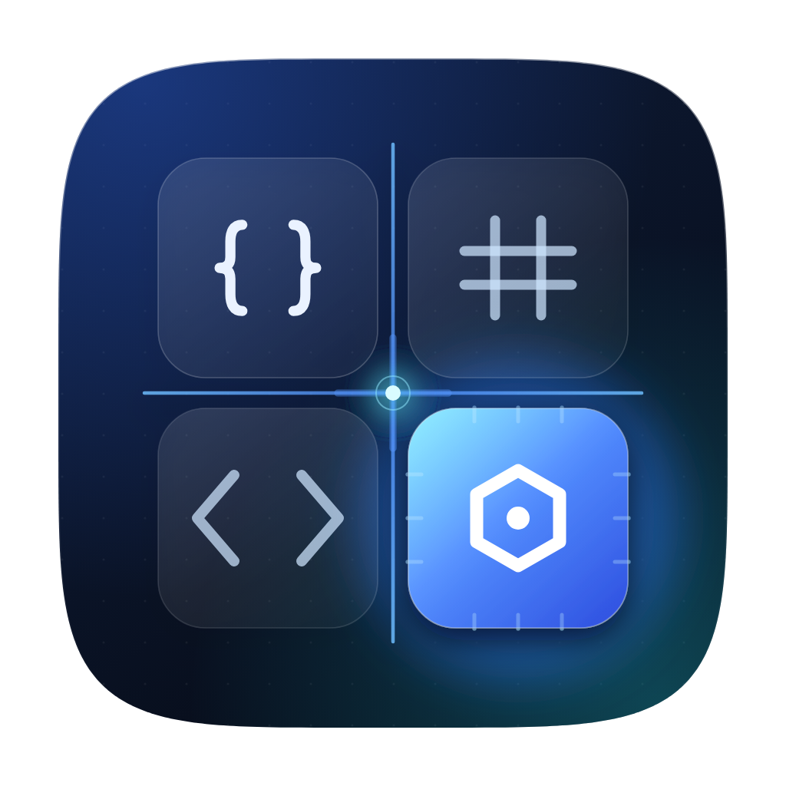
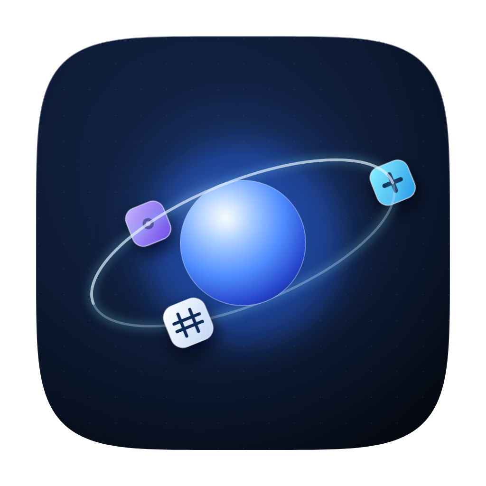
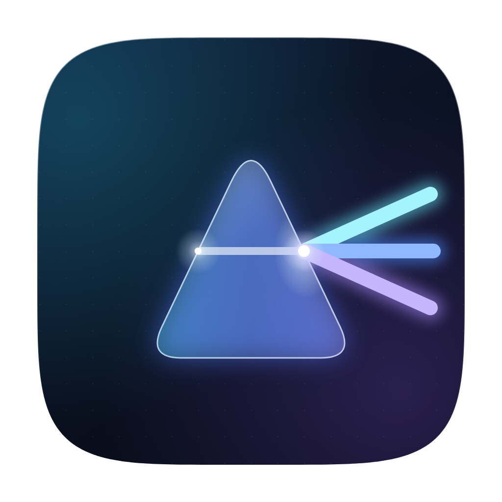
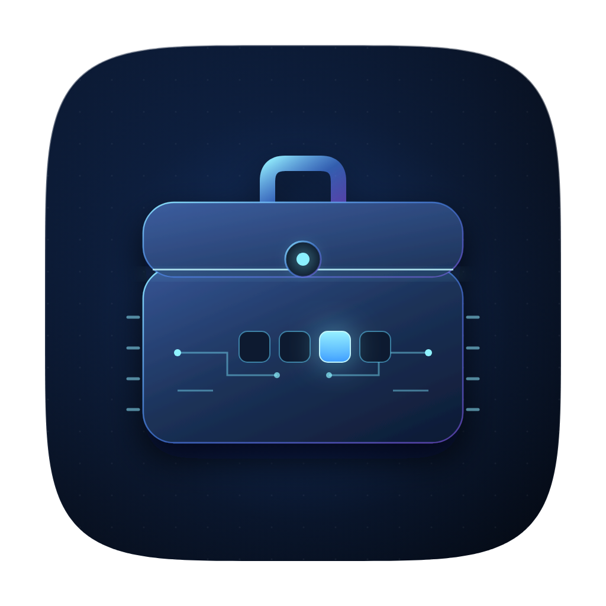
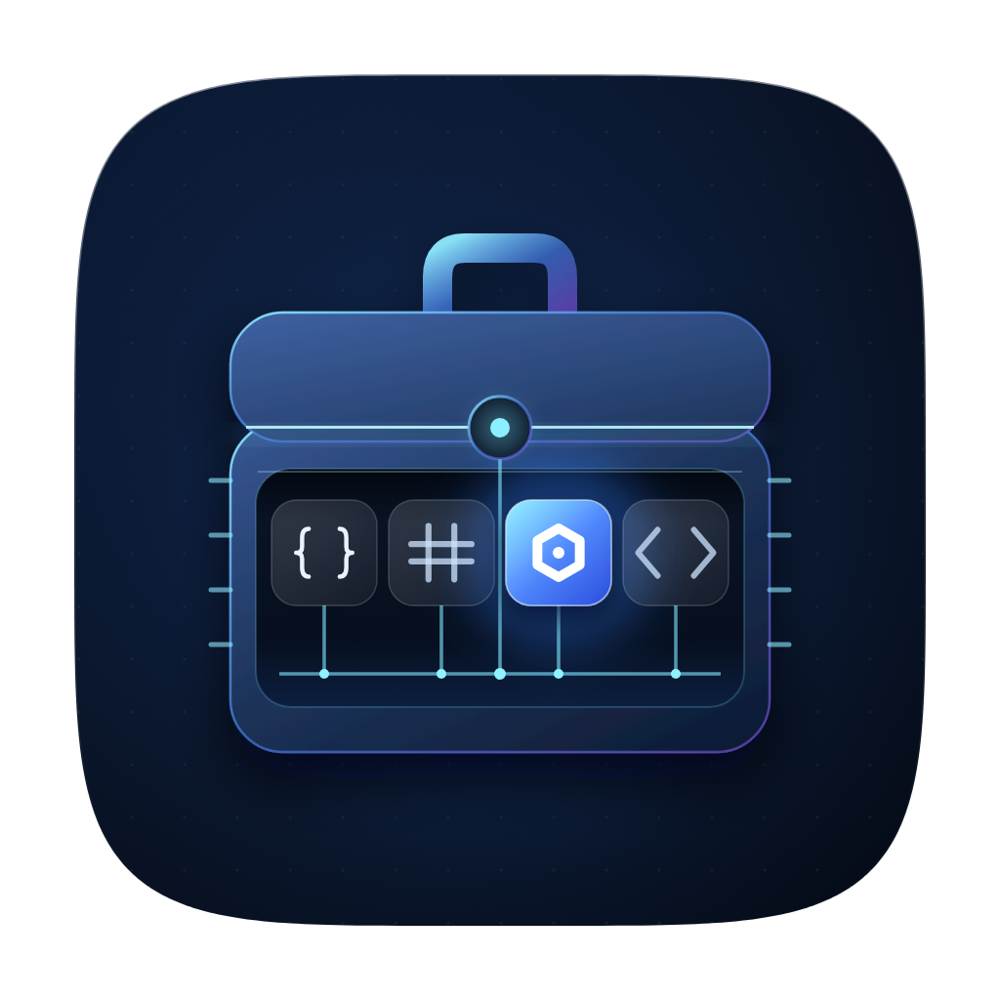
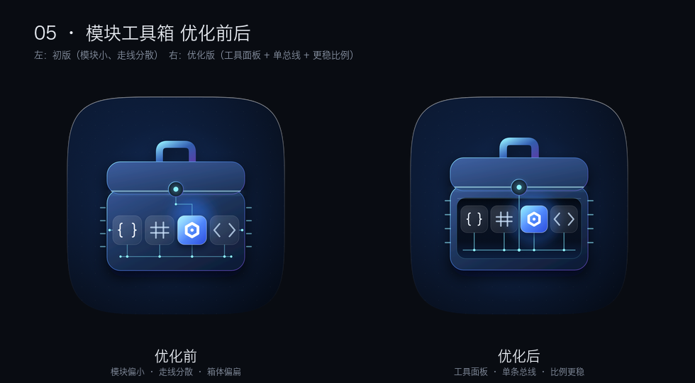

# 第二轮 · 科技感方向（5 个备选）

> **已选用 05 · 模块工具箱，并已完成项目替换（2026-11-07）；随后针对深色模式提亮了一版并已应用。** 落地记录见文末；其余方向保留为备选。
> 五个方向都围绕「工具 + 集合」，调性比第一轮更冷、更工程化：深色科技底、玻璃质感、发光边缘、电路/轨道/光学元素。

首批查看：[四个方向对比图](preview/compare-v2-dark.png) · [浅色背景版](preview/compare-v2-light.png)

---

## 01 · 模块网络 — Nexus Grid

- **画面**：四块玻璃工具模块（`{}`、`#`、`<>`、六角螺母）嵌在一块共用背板上；中间一条冷光总线十字贯穿，中心是接点；当前模块高亮，带芯片引脚。
- **表达**：「集合」= 四个模块共用一套总线；「工具」= 螺母/花括号/井号这些开发工具符号。
- **科技感来源**：HUD 式的总线十字、玻璃卡片、引脚刻线、边缘辉光。
- **小尺寸**：16 px 仍能读出「四格 + 一块亮」，是四个方案里小尺寸最稳的。
- **注意**：十字线有「坐标轴」的联想，若不喜欢可以改成 L 形走线。

## 02 · 轨道核心 — Orbit Core

- **画面**：一颗高光核心球，一条倾斜轨道，三个工具模块（`+`、`#`、`•`）沿轨道运行。
- **表达**：「集合」= 工具围绕核心组成生态；「工具」= 轨道上的模块化工具块。
- **科技感来源**：球体高光、环形轨道的前后穿插、模块的悬浮投影、深空底色。
- **小尺寸**：128 px 很有辨识度；32 px 读成「发光核心 + 环」；16 px 略偏「星球」。
- **注意**：容易被读成「星球/原子」，工具语义主要靠三个模块块。

## 03 · 棱镜分流 — Prism Split

- **画面**：一束白光穿过玻璃三棱镜，在右侧分成青 / 蓝 / 紫三束工具光；入射点和出射点有高光。
- **表达**：「工具」= 编码、格式化、转换这些「把一种输入变成另一种输出」的能力；「集合」= 一束输入分出多种结果。
- **科技感来源**：光学折射、玻璃边缘、彩色光束与辉光。
- **小尺寸**：三角形轮廓 + 三色扇形，32 px 仍可辨认。
- **注意**：三角形棱镜容易让人联想到 Prisma（数据库工具），且「集合」语义弱于另外三个。

## 04 · 电路工具箱 — Circuit Case

- **画面**：深蓝玻璃工具箱，霓虹提手、发光箱缝、中央锁扣；箱体上四个工具插槽（一个点亮），四周是电路走线与芯片引脚。
- **表达**：「工具」= 工具箱本体；「集合」= 四个插槽 / 四个可点亮的工具位。
- **科技感来源**：玻璃箱体、霓虹描边、发光插槽、PCB 走线、侧边引脚。
- **小尺寸**：128 px 箱子轮廓清楚；32 px 仍能看出「箱体 + 一排灯」；16 px 偏暗。
- **注意**：轮廓仍接近「手提箱」，但电路与插槽把它拉回「工具盒」。

## 05 · 模块工具箱 — Module Case（已选用 · 已应用）

**优化前后：**

- **画面**：沿用 04 的玻璃箱体、霓虹提手/箱缝/锁扣与侧边引脚；箱体正面是一块下沉的「工具面板」，里面放 01 的四块工具模块（`{}`、`#`、六角螺母、`<>`），第三块点亮；锁扣向下引一条总线，四块模块从底部接入。
- **优化点**：
  1. 增加下沉工具面板，模块有了「设备屏幕」的承托，不再直接浮在箱体上；
  2. 走线收敛为「锁扣 → 单条总线 → 四个分支」，去掉之前分散的侧线和折线；
  3. 模块与字形按统一视觉重量重排（字形高度约 50、描边一致），箱体比例加高，不再显得扁；
  4. 侧边引脚接到箱体边缘，面板增加内侧投影与底部反光。
- **表达**：工具箱 + 四件工具 + 共享总线的合体。
- **小尺寸**：128 px 能看到箱体、面板和四块模块；16 px 回到「箱体 + 一排亮点」，与 04 接近。
- **深色模式提亮（已应用）**：底色由近黑抬到深蓝（`#1F4274 → #081426`），箱体、模块边框、字形和走线整体提亮，工具面板保持深色以保留对比。真实 106 px 对比见 `preview/compare-05-brightness.png`，源文件为 `src-v2/v2-module-case-bright.svg`。

---

## 对比与建议

| | 工具语义 | 集合语义 | 科技感 | 小尺寸 | 记忆点 |
| --- | --- | --- | --- | --- | --- |
| 01 模块网络 | 中 | **强** | 中 | **强** | 中 |
| 02 轨道核心 | 中 | **强** | **强** | 中 | **强** |
| 03 棱镜分流 | **强** | 弱 | 强 | 中 | 中 |
| 04 电路工具箱 | **强** | **强** | **强** | 中 | 中 |
| 05 模块工具箱 | **强** | **强** | **强** | 中 | **强** |

- 想要「一看就是工具箱」→ **04**。
- 想要「工具集合、模块化」→ **01**。
- 想要最有记忆点、最适合做品牌符号 → **02**。
- 想要最优雅、最能讲「转换」故事 → **03**。
- 想要「箱子 + 模块 + 线路」全都占 → **05**（本次按需求组合）。

我的推荐顺序：**05 ≈ 04 > 01 > 02 > 03**。05 信息最全、最贴合「工具箱里装着工具」；04 在 16 px 下更干净；01 的模块化最清楚。

---

## 文件

- 矢量源：`src-v2/v2-*.svg`（1024 × 1024，含 `v2-module-case.svg`）
- 透明 PNG：`render-v2/v2-*.png`
- 对比图：`preview/compare-v2-dark.png`、`preview/compare-v2-light.png`
- 生成脚本：`tools/generate-v2.py`（Chrome headless 渲染见 `tools/render-v2.sh`）

选定后再用与 B 相同的流程落地：
`pnpm --filter @devdeck/desktop exec tauri icon <selected>.png --output apps/desktop/src-tauri/icons`。

---

## 落地记录（方案 05）

| 位置 | 变更 |
| --- | --- |
| `apps/desktop/app-icon.png` | 替换为 05 提亮版的 1024 源图（`v2-module-case-bright.png`） |
| `apps/desktop/src-tauri/icons/` | 由 `tauri icon` 重新生成：`32x32`、`64x64`、`128x128`、`128x128@2x`、`icon.png`、`icon.icns`、`icon.ico`、`Square*Logo`、Android/iOS 全套 |
| `apps/desktop/src/assets/brand-mark.svg` | 由 05 矢量源裁切，用于「关于」对话框 |
| `apps/desktop/public/favicon.png` | 由 128 PNG 同步 |
| 项目根 `build/` | 仓库清理后已不存在，旧 Electron 壳不再维护，未同步 |

验证：

- `pnpm --filter @devdeck/desktop build` 通过
- `icon.icns` 内含 1024 帧、`icon.ico` 含 16–256 多尺寸
- `apps/desktop/dist` 已包含新的 `brand-mark-*.svg` 与 `favicon.png`
